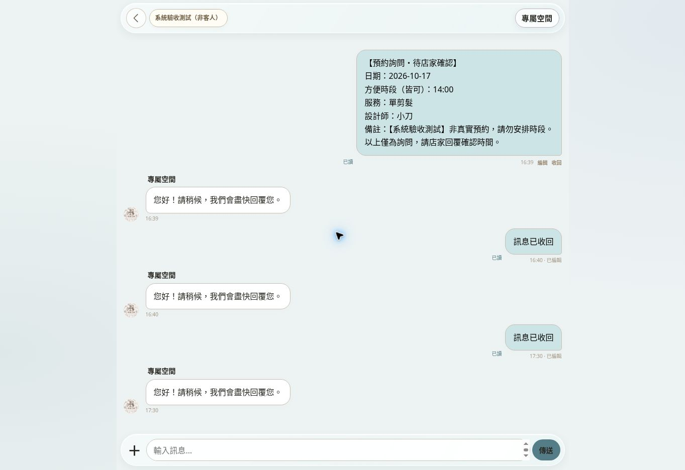

# 專屬空間聊天系統：穩定性修正與驗收報告

日期：2026-10-16（台灣時間）  
發布版本：N32  
程式修正：250d0f4、243c3b7；GitHub Pages 兩次部署均成功。

## 結論

已修正本輪確認的程式錯誤，並以正式客人端的專用測試帳號驗證訊息編輯、收回、照片上傳、放大、下載及刪除。這些流程目前通過。反覆開關商品視窗及進出聊天室，沒有再遇到卡死或殘留遮罩。

這是有範圍的驗收結果，並非所有手機、所有網路或背景通知百分之百保證。實際曾出現一次 Firebase 權限拒絕；已加上同步失敗的重試及恢復機制，最後重新載入後已讀顯示恢復正常，但該次權限拒絕的根因尚未確認。

## 本次修正

| 問題 | 修正 | 驗證 |
|---|---|---|
| 編輯訊息出現 reviseMessage is not defined | 補回交易式修改，限制欄位及身分；最新訊息摘要同步且不覆蓋較新訊息 | 實際編輯成功並顯示已編輯；回歸測試通過 |
| 收回文字、刪除照片使用同一缺少函式 | 統一使用已修復的修改流程 | 文字與測試照片均實際收回成功 |
| 不存在的教學按鈕使啟動程式中斷 | 改為存在才綁定事件 | 背景恢復事件註冊回歸測試、正式頁重新載入通過 |
| 確認視窗被取代，等待中的操作可能不結束 | 先關閉舊視窗，讓取消結果完成，再開新視窗 | 回歸測試及取消後再次操作通過 |
| 圖片載入期間切換對話可能套到錯誤頁面 | 固定原對話及節點，只更新仍有效的畫面 | 程式檢查；實際照片流程通過 |
| 離開頁面後仍建立商品／休假監聽 | 隱藏頁面不再新增該監聽 | 程式檢查、切換頁面操作 |
| 載入失敗停留在讀取提示 | 可恢復的內容頁提供重新載入與返回 | 程式檢查 |
| 已讀監聽失敗後沒有恢復入口 | 明確顯示重試，返回前景時可重建失敗的監聽 | 回歸測試；最後實際已讀正常 |
| 快捷詢問與常用訊息行為不一致 | 快捷詢問先帶入文字，由客人確認傳送 | 實際點選後只帶入輸入框，未自動傳送 |
| 電腦顯示 Android 安裝步驟 | 區分電腦、Android、iPhone／iPad 與內嵌瀏覽器 | 電腦實際顯示 Chrome／Edge 教學 |

## 實際操作記錄

- 專用測試帳號建立、店家核准後進入成功。
- 預約詢問包含日期、時段、服務、設計師與測試備註；沒有替客人建立已確認預約。
- 一般文字可傳送，客人端實際收到自動回覆。
- 店家已讀狀態可在客人端顯示；重新開啟後訊息保留。
- 訊息修改成功；取消收回後可再次操作；確認收回後顯示「訊息已收回」。
- 1200 × 800 測試照片成功傳送、直接顯示、放大、下載。下載檔實際為 1200 × 800 JPEG。
- 照片刪除後聊天保留收回紀錄；開啟視窗數為 0，body 未殘留 overflow 捲動鎖定。
- 商品視窗與聊天室連續進出三輪均可繼續操作。
- 白金角蛋白兩張圖片可進入檢視；照片關閉後回到商品內容。
- 首頁、活動、主打內容、店家資訊、商品、設定與預約詢問頁進入／返回可操作。
- 字體與減少動態設定重新整理後保留，驗證後已恢復原設定。
- 空白回報會阻擋送出；客人端沒有測試推播按鈕。
- 店家端僅以「操作範例」驗證功能開關、常用訊息設定、訊息列表與返回，不等同登入店家正式帳號的完整驗證。

測試瀏覽器選取上傳檔案的一次操作回應異常久；選檔完成後的傳送、下載與收回可完成。尚無證據能將這段延遲判定為手機網站本身的卡頓。

## 自動化與負載模擬

29 組非模擬器測試通過；另有 2 組 Firebase 模擬器測試通過（安全規則及個人資料交易）。N32 再次執行 npm test 通過。

| 模擬收件人 | 每人兩張照片加一則文字 | 結果 |
|---:|---:|---|
| 100 | 300 筆 | 通過 |
| 200 | 600 筆 | 通過 |
| 300 | 900 筆 | 通過 |
| 400 | 1,200 筆 | 通過 |

涵蓋：斷線／重開後接續傳送、回應遺失時重試、重複送達防護、佇列額度失敗回復、200／300 組模擬自動回覆、新客加入通知去重、已讀狀態跨裝置不能倒退、私人資料及附件隔離。

自動回覆排除店家裝置的測試通過，包括同一推播 token 同時存在兩端時，不對店家裝置發出自動回覆推播。Cloudflare Worker 本次沒有修改，無須重新部署。

這些負載結果是模擬請求，不是向真實 400 位客人群發，也不是正式 Firebase／FCM 配額及延遲的實測證明。

## 尚不能宣告通過的範圍

- iPhone／Android 實機鎖屏推播、桌面角標、長時間背景待機及實體觸控滑動：本環境為桌面雲端瀏覽器，不能等同實機驗收。
- 測試瀏覽器通知權限為拒絕，因此沒有實際接收到系統背景通知的證據。
- 已讀同步曾被正式雲端拒絕權限，最後重載正常；恢復機制已補強，但拒絕原因尚未確定。
- 不宣告「所有潛在 bug 已清除」或「任何情況都不會卡住」。

## 後續體驗建議（本輪未改動店家內容）

主打服務應使用具體服務名稱；商品可補上分類。換機與找回帳號目前仍需店家協助，未擅自啟用新的身分驗證方式。忙碌自動回覆可考慮設定同一對話的回覆間隔，避免連續重複。

## 驗收畫面

